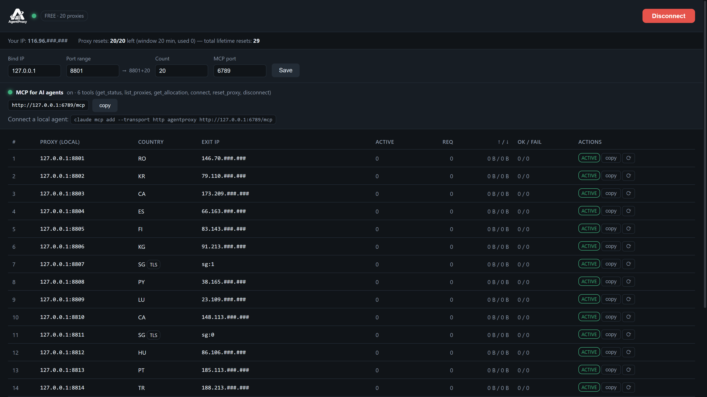
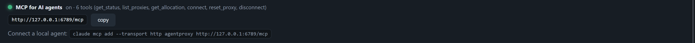
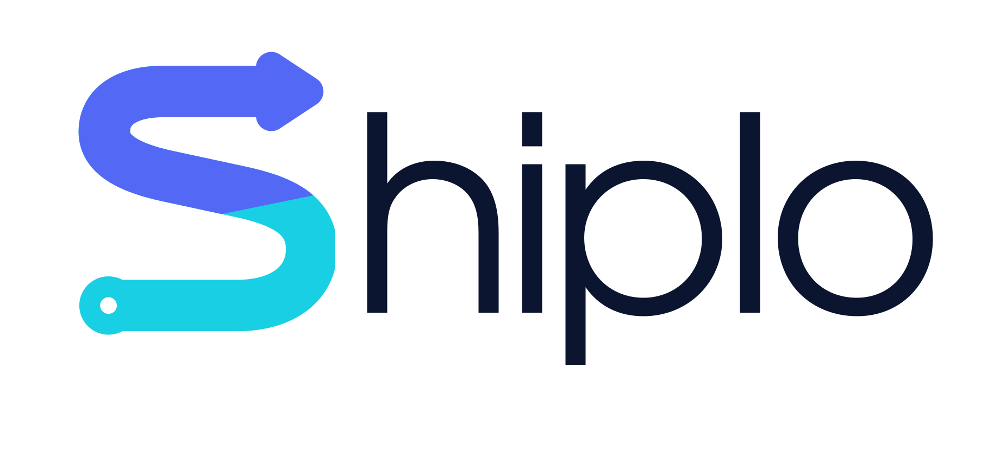

# AgentProxyRover

**Give your local AI agents their own fleet of HTTP proxies.**

AgentProxyRover is an Electron desktop app that turns free public proxies found
on the internet into clean, ready-to-use local endpoints — `127.0.0.1:8801`,
`127.0.0.1:8802`, … — one per proxy, with a built-in **MCP server** so AI agents
(Claude Code, Cursor, Cline, …) can list, connect, rotate and disconnect them
by themselves.

Free proxies are noisy: most lists on the internet are 90% dead or unusably
slow. AgentProxyRover does the filtering for you — candidate proxies are
continuously scraped from public sources, then **validated, latency-tested and
health-checked, and only the best survivors ever reach your allocation**. You
get up to **20 working proxies per public IP**, each pinned to its own local
port, with per-proxy stats (requests, bytes up/down, OK/fail) live in the UI.

<p align="center">
  
</p>

## Highlights

- **Free proxies, carefully filtered** — the pool is sourced from free public
  proxy lists on the internet; every candidate is connect-tested and
  latency-checked, and only healthy, reasonably fast exits are kept. Dead exits
  are reported and replaced automatically.
- **Built for AI agents** — a first-class MCP (Model Context Protocol) server
  runs inside the app. One line connects your agent:
  `claude mcp add --transport http agentproxy http://127.0.0.1:6789/mcp`
- **Plain HTTP proxies** — every endpoint is a standard forward proxy, so
  anything that speaks `curl -x http://127.0.0.1:8801 …` works: agents, scripts,
  browsers, scrapers.
- **Rotate on demand** — swap one proxy onto a fresh exit IP without changing
  its local address. Free tier: 20 resets per rolling 20-minute window.
- **Local-only by design** — proxies and the MCP server bind to `127.0.0.1`,
  foreign `Host`/`Origin` headers are rejected (DNS-rebinding guard), no CORS.
  Nothing is exposed to your network.
- **Live stats** — per-proxy active connections, request counts, traffic and
  OK/fail ratios, right in the app.

## How it works

A hosted pool service (sponsored by **[Shiplo.site](https://shiplo.site)**)
does the heavy lifting: it continuously scrapes free public proxy sources,
connect-tests and measures every candidate, keeps only the best ones, and hands
your device an **allocation of up to 20 proxies bound to your public IP**. The
app maps that allocation 1:1 onto local ports (`portStart` … `portStart+count`)
and relays traffic:

```
AI agent ──> http://127.0.0.1:8801 ──[app]──> filtered free proxy ──> internet
                                       ▲
MCP (127.0.0.1:6789/mcp) ──────────────┘   list / connect / reset / disconnect
```

Upstream credentials are managed internally and refreshed automatically —
a failing exit is reported and re-credentialed on the fly, so an agent never
sees a dead proxy more than once.

## MCP — control the app from your agent

The app exposes a stateless **MCP Streamable-HTTP** server on
`http://127.0.0.1:6789/mcp` (port is configurable in the UI).

```bash
# Claude Code
claude mcp add --transport http agentproxy http://127.0.0.1:6789/mcp
```

| Tool           | What it does                                                                 |
| -------------- | ---------------------------------------------------------------------------- |
| `list_proxies` | Live local endpoints: listen address, country, exit IP, revoked, connections, OK/fail stats (optional `country` filter) |
| `get_allocation` | The proxies assigned to your public IP — without starting anything          |
| `get_status`   | App status: running, public IP, settings, MCP endpoint, reset quota          |
| `connect`      | Bind the local proxy ports (same as pressing **Connect**)                    |
| `reset_proxy`  | Rotate one proxy onto a different exit IP (uses 1 reset, quota-limited)      |
| `disconnect`   | Stop all local proxies and release the ports                                 |

Typical agent usage:

```bash
curl -x http://127.0.0.1:8801 https://api.ipify.org   # exit through proxy #1
```

<p align="center">
  
</p>

## Getting started

### Download a build (Windows)

Grab a ready-made exe from the
**[Releases page](https://github.com/duonglabs/AgentProxyRover/releases)**
(<https://github.com/duonglabs/AgentProxyRover/releases>) — pick the latest
version and download one of:

| File | What it is |
| --- | --- |
| `AgentProxy-Setup-<version>.exe` | Windows installer (per-user, Start Menu shortcut) |
| `AgentProxy-Portable-<version>.exe` | Single portable exe — no install, just run |

Download one, run it, press **Connect** — done.
> Note: the builds are not code-signed, so Windows SmartScreen may show a
> warning — click **More info → Run anyway**.

### Run from source

Requires Node.js 18+.

```bash
npm install        # first time (downloads Electron)
npm start          # run the app
```

On launch: set **Bind IP** (default `127.0.0.1`), **port range** (default
`8801 + 20`), press **Connect**, and copy any `ip:port` row into your agent or
script.

### Build the Windows exe

```bash
npm run dist       # NSIS setup + portable exe into dist/
```

## Tests

```bash
BACKEND_URL=http://127.0.0.1:7788/api/v1 npm run smoke   # headless e2e: auth → allocation → 3 real tunnels → same-IP quota
node tools/mcp-smoke.js                                  # MCP protocol tests (no network)
BACKEND_URL=http://127.0.0.1:7788/api/v1 node tools/mcp-smoke.js --live   # + real tools
node tools/revoke-demo.js                                # kill-switch demo
```

## Architecture

```
main.js                Electron lifecycle + IPC + MCP bootstrap
lib/
  proxy-manager.js     settings, N engines, allocation fetch, usage reporting, reset/rotate
  proxy-engine.js      local forward proxy (CONNECT relay + HTTP absolute-URI), per-port stats
  upstream-provider.js upstream credential cache + refresh on failure (407/timeout)
  backend-client.js    device identity + REST client for the hosted pool service
  mcp-server.js        MCP Streamable-HTTP transport (JSON-RPC), zero dependencies
  mcp-tools.js         tool definitions (shared with headless tests)
renderer/              vanilla-JS UI (no framework)
tools/                 smoke tests & demos
```

## Disclaimer

This project consumes **free, public proxies** that anyone on the internet can
publish. That means:

- **Never send credentials, personal data or anything sensitive through free
  proxies** — assume every hop can read unencrypted traffic.
- Exit IPs are third parties; expect rate limits, downtime and occasional
  misbehavior.
- Use only for lawful purposes (testing, scraping where permitted, geo checks)
  and respect the terms of the sites you visit.

## Sponsor

<p align="center">
  <a href="https://shiplo.site"></a>
</p>

Sponsored by **[Shiplo.site](https://shiplo.site)** — the hosted pool service
that keeps the free-proxy fleet filtered and healthy.
